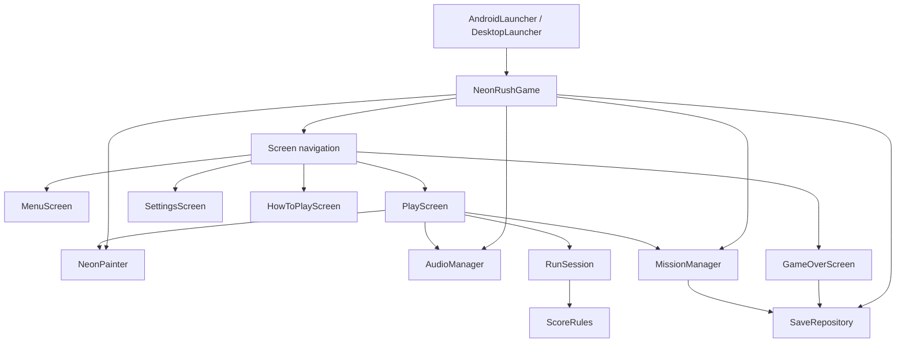

# NEON RUSH Architecture

**Scope:** v0.3.0 source package reviewed on October 20, 2026; runtime behavior is not independently validated on Android.

## Component diagram

## Modules

| Module | Responsibility |
| --- | --- |
| `android/` | Android app launcher, manifest, APK configuration, Android-specific lifecycle. |
| `core/` | Engine-independent rules, UI/game screens, shared rendering, audio, persistence, missions. |
| `lwjgl3/` | Desktop launcher for quicker development checks. |
| `assets/` | Original project WAV music and effects. |

## Main classes

- **NeonRushGame** extends LibGDX `Game`, owns shared services and changes active screens.
- **BaseScreen** wraps `FitViewport(480f, 800f)`, touch coordinate conversion, and common screen drawing setup.
- **MenuScreen / SettingsScreen / HowToPlayScreen / GameOverScreen** own respective presentation and navigation events.
- **PlayScreen** translates keyboard and mobile touch into gameplay commands; it advances the simulation only when the run is not paused.
- **RunSession** stores lane, obstacle/orb objects, timer, distance, jump/slide duration, collisions, and per-run statistics. This module contains no Android dependencies.
- **ScoreRules** computes score, movement speed and obstacle interval, and is suitable for ordinary JVM tests.
- **MissionManager** defines six ordered per-run missions and writes completion state to local preferences when the run ends.
- **SaveRepository** persists sound/music preferences, high score and mission progress using LibGDX `Preferences`.
- **AudioManager** owns/cleans up shared `Sound` and `Music` resources and follows app pause/resume events.
- **NeonPainter** draws the neon world, UI, obstacles, and the reference-photo-inspired cartoon runner with procedural geometry. It disposes its LibGDX resources.

## Gameplay data flow

1. Player taps a button or swipes; `PlayScreen` interprets direction/action.
2. `PlayScreen` calls `RunSession.moveLeft`, `.jump`, `.slide`, etc.
3. `RunSession.step(dt)` updates objects and collisions; delta is capped for frame stalls.
4. `PlayScreen` reads the current session and draws through `NeonPainter`.
5. On collision, `RunSession.summary()` is passed to `MissionManager`, which records completed mission progress, and `SaveRepository` records best score.
6. `GameOverScreen` displays the statistics and mission outcome.

## Constraints and known design tradeoffs

- Fixed logical 480×800 `FitViewport` keeps a stable portrait coordinate system but can letterbox taller phone displays. Fully adaptive layout is a future milestone.
- No production network backend, online leaderboard, C++ engine, or multiplayer implementation is present.
- Missions update upon run end, not asynchronously mid-run.
- Android CI and device verification are tracked separately in `docs/TESTING.md`.
